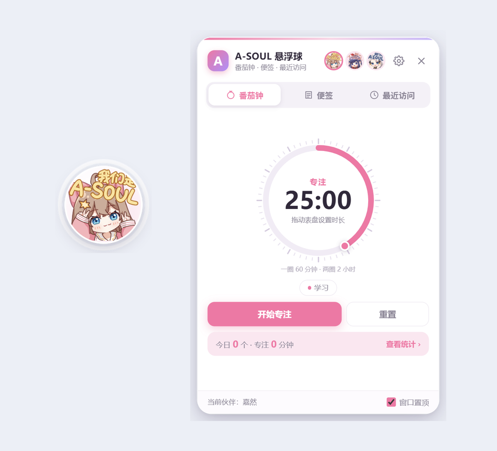
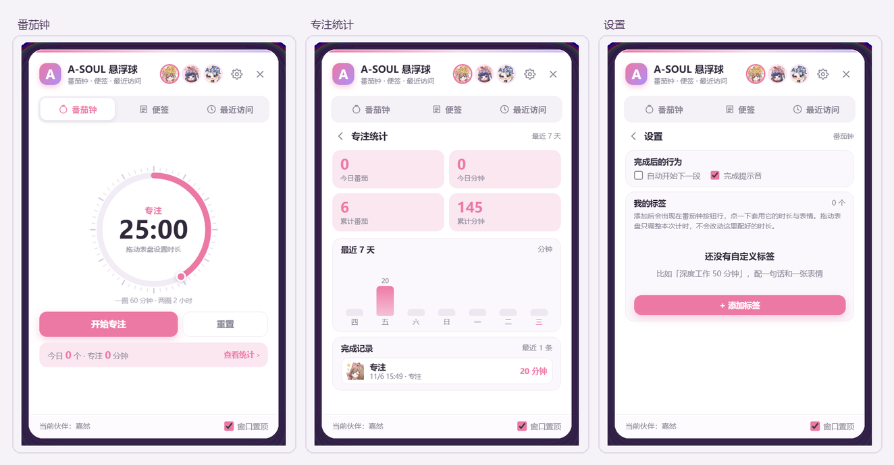

# A-SOUL 悬浮球

一个常驻 Windows 桌面的透明小悬浮球，点开就是番茄钟、便签和最近访问的文件与文件夹。

嘉然 / 贝拉 / 乃琳三种形象，11 种表情随状态切换。基于 Electron 41 构建，除了 Electron 本身没有第三方运行时依赖，装完就常驻一个 124px 的球。



---

## 功能

### 悬浮球

- 透明无边框、始终置顶（可在托盘开关），不占任务栏
- 拖动任意位置，位置会记住；贴边不会跑出屏幕
- 表情跟着状态走：空闲发呆、专注认真、休息放松、完成欢呼，还有 hey / wink / love 等彩蛋时刻
- 左键点开面板，右键出快捷菜单（便签、最近访问、统计、开始/暂停、切角色、隐藏）
- 托盘常驻：单击打开面板，右键切换角色、调整置顶、番茄钟控制、开机自启、退出
- 开机自启：设置页和托盘菜单都能开关，两边状态实时同步；以系统实际注册项为准，手动清过注册表也不会显示错

### 番茄钟

- **转盘设时长，不用输数字**：拖表盘就行，1/4 圈 = 15 分钟、一圈 = 60 分钟、两圈 = 2 小时（上限 120 分钟）。超过一圈会提示「第 2 圈」
- **自定义标签**：在设置里建自己的标签（名称 / 时长 / 专注或休息 / 完成话语 / 表情），建好就出现在按钮行，点一下套用这个时长
- 按钮只有**开始·暂停**和**重置**，没有「跳过」这种干扰项
- 结束后：表情切换 → 可选提示音 → 可选语音朗读你写的完成话语 → 自动记入统计
- 专注/短休/长休的默认时长在代码里是 25 / 5 / 15，界面上不给数字输入框，全部靠转盘

### 便签

- 多张便签、五种颜色、可置顶、可删除
- 输入即保存（防抖写入，不怕崩溃丢数据）

### 最近访问

- 列出最近打开过的**文件和文件夹**，不是「最近下载」
- 实现是解析 Windows 自己的「最近使用的项目」（`%APPDATA%\Microsoft\Windows\Recent\*.lnk`），不需要后台监控或索引
- 按目标路径去重、过滤失效快捷方式和系统 GUID 项，可筛选只看文件或只看文件夹
- 点一行直接打开，右侧按钮在资源管理器中定位

### 专注统计

- 今日番茄数 / 今日专注分钟 / 累计番茄 / 累计分钟
- 最近 7 天柱状图
- 最近 60 条完成记录

---

## 界面总览

番茄钟 / 专注统计 / 设置三个视图：



---

## 下载安装

到 [Releases](https://github.com/8946ben/aXFQ/releases) 下载：

| 文件 | 说明 |
| --- | --- |
| `ASOUL-Floating-Ball-Setup-1.0.0.exe` | 安装版，可选安装目录，自动创建桌面和开始菜单快捷方式 |
| `ASOUL-Floating-Ball-Portable-1.0.0.exe` | 便携版，双击即用，不写注册表 |

> 安装包没有代码签名，首次运行 Windows SmartScreen 可能拦一下：「更多信息」→「仍要运行」。

系统要求：Windows 10 / 11（x64）。

---

## 使用

| 操作 | 效果 |
| --- | --- |
| 拖动悬浮球 | 移动位置 |
| 左键单击悬浮球 | 打开面板 |
| 右键单击悬浮球 | 快捷菜单 |
| 拖动表盘 | 设定本次计时时长 |
| 点击标签按钮 | 套用该标签的名称、时长和表情 |
| 设置 → 开机自动启动 | 登录 Windows 后自动显示悬浮球 |
| 托盘图标单击 | 打开面板 |
| 托盘图标右键 | 角色 / 置顶 / 开机自启 / 隐藏 / 退出 |

同一时间只能跑一个实例（第二个启动会激活已有的球）。

---

## 数据存在哪

```
%APPDATA%\asoul-floating-ball\state.json
```

一个 JSON 文件装下全部状态：角色、球的位置、番茄钟设置、自定义标签、统计、完成记录、便签。想重置就直接删掉它，想备份就复制走。

---

## 开发

需要 Node.js 20+。

```bash
npm install       # 装 Electron 与 electron-builder
npm start         # 启动（走 launch.js）
npm run dist      # 打包到 dist/
```

国内网络打包时，electron 二进制容易 502，先设镜像：

```bash
export ELECTRON_MIRROR=https://npmmirror.com/mirrors/electron/
export ELECTRON_BUILDER_BINARIES_MIRROR=https://npmmirror.com/mirrors/electron-builder-binaries/
npm run dist
```

也可以直接双击 `start.bat`。

### 关于 `launch.js`

它是启动器，干两件事：

1. 找一个可用的 `electron.exe`（本项目的 `node_modules`、本机已有的安装、或环境变量 `ASOUL_ELECTRON` 指向的路径）
2. **剥掉 `ELECTRON_RUN_AS_NODE` 环境变量**——在 WorkBuddy / Claude Code 这类 Electron 宿主里这个变量会被子进程继承，Electron 会退化成纯 Node，进程在跑但屏幕上什么都没有

设 `ASOUL_CDP=1` 会开放 `--remote-debugging-port=9222`，方便自动化验证。

### 打包版同样要注意

直接双击 `dist/win-unpacked/A-SOUL 悬浮球.exe` 不会继承宿主的环境变量，没问题。但从命令行启动打包版时，同样要清掉 `ELECTRON_RUN_AS_NODE`：

```bash
env -u ELECTRON_RUN_AS_NODE -u NODE_OPTIONS "./A-SOUL 悬浮球.exe"
```

---

## 项目结构

```
main.js          主进程：窗口、托盘、计时器、状态持久化、最近访问解析、IPC（723 行）
preload.js       contextBridge 暴露 window.asoul，通道白名单
launch.js        零依赖启动器（剥环境变量、选 electron.exe）
start.bat        一键启动
src/
  ball.html/css/js    悬浮球窗口（164 行 js）
  panel.html/css/js   面板：番茄钟 / 便签 / 最近访问 / 设置 / 统计（648 行 js）
assets/
  stickers/{diana,bella,eileen}/*.png   3 角色 × 11 表情，162×162 透明
  icon.ico / icon.png / preview.png / screenshot.png
```

架构上就是「两个 BrowserWindow + 一个 JSON 状态文件」：`ball` 窗口只显示表情和挂表圈的进度环，`panel` 窗口承载全部交互，两者通过 IPC 和 `state:changed` 广播同步。

---

## 内存与性能

打包版实测（5 个进程）：

| 状态 | 私有提交 | 工作集 |
| --- | --- | --- |
| 常驻（只有球） | 222 MB | 450 MB |
| 面板打开 + 计时中 | 280 MB | 530 MB |

任务管理器里看到的「内存」列是**专用工作集**，常驻约 145 MB——工作集总和里有一大半是 5 个进程重复计算的同一批 Chromium DLL。

- 空转 60 秒内存不涨；计时中连续 90 秒稳定在 ±3 MB，没有泄漏
- 闲置 CPU 约 0.07% 单核，透明窗口没有持续重绘
- 渲染层 JS 堆只有 10 MB，内存全在引擎基线

---

## 已知限制

- **仅 Windows**：最近访问直接读 Windows 的 Recent 目录，换平台要重写
- **便携版不支持开机自启**：便携版是自解压包，每次启动解压到 `%TEMP%` 下的固定目录、退出即删，自启项指向的路径留不住。设置里的开关会置灰并说明原因。需要自启请用安装版
- **最近访问依赖系统记录**：你在系统设置里关掉「最近使用的项目」，这里就空了
- 没有全局快捷键，呼出面板靠点球或托盘
- 安装包未签名，SmartScreen 会提示
- 自定义标签上限 12 个，完成记录保留最近 500 条 / 展示 60 条

---

## 素材声明

角色形象与表情素材来自 A-SOUL 官方，版权归原权利方所有，此处仅作个人桌面工具使用，不用于任何商业用途。如果你要分发或二次开发，请自行确认素材授权。

代码部分随你使用。
